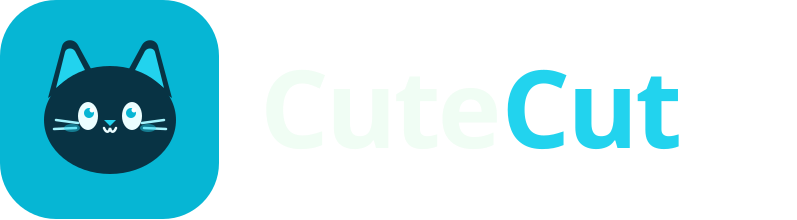
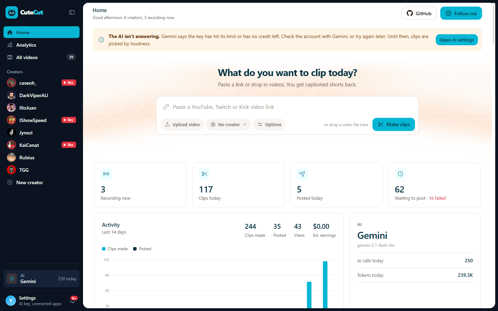

<p align="center">
  
</p>

<p align="center">
  <b>Turn long videos and live streams into captioned vertical clips, ready to post.</b><br>
  Free, private and self-hosted with multi-key rotation and intelligent publishing.
</p>

<p align="center">
  <a href="#quick-start"></a>
  <a href="LICENSE"></a>
  <a href="https://github.com/q28i/cutecut"></a>
</p>

---

<p align="center">
  
</p>

---

Paste a YouTube, Twitch or Kick link (or drop a video file) and **CuteCut** transcribes the speech on your device, asks an AI to extract high-retention moments, crops them into modern 9:16 vertical clips, adds word-by-word highlighted captions, and can publish directly to your connected YouTube, TikTok, and Instagram accounts.

---

## ⚡ Key Highlights

- 🐾 **Fresh CuteCut Aesthetic**: Polished cyan interface with quick navigation, dark theme sidebar, and clean controls.
- 🔑 **Multi-Key API Rotation Pool**: Add multiple API keys (Gemini, OpenAI, Groq, Grok, Claude, etc.) with custom labels. When any key hits rate limits or token quotas, CuteCut automatically fails over to the next healthy key with zero workflow disruption.
- 📅 **Smart Auto-Schedule Publisher**: Queue and schedule video shorts smoothly with automated cooldown spacing (e.g. 45m between posts) preventing mass-spam bursts if the server is started late.
- 🎙️ **On-Device Speech-to-Text**: Speech is transcribed locally via `sherpa-onnx` and the fast Parakeet model. Your audio and transcripts never leave your own machine.
- 🔴 **Live Stream Clipping**: Monitor and record active live streams (Twitch, Kick, YouTube) into rolling buffers, extracting viral moments in real time.
- 🎨 **Dynamic Captions & Layouts**: Choose from *Bounce*, *Hype*, and *Clean* animated caption presets with customizable highlight colors and smart framing (blurred fill, center zoom, or screen crop).
- 🔒 **Zero Sign-In Friction**: By default, CuteCut runs locally on your computer with full owner control. Switch multi-user accounts on (`PEAKCUT_ACCOUNTS=1`) when self-hosting on a public server.

---

## 🚀 Quick Start

CuteCut requires **Python 3.10+** and **FFmpeg**.

### 1. Install FFmpeg
- **Windows**: `winget install Gyan.FFmpeg`
- **macOS**: `brew install ffmpeg`
- **Linux**: `sudo apt install ffmpeg`

### 2. Clone & Install

```bash
git clone https://github.com/q28i/cutecut.git
cd cutecut
pip install -r requirements.txt
```

### 3. Start CuteCut

```bash
python -m studio.server
```

*(On Windows, you can also double-click `start.bat`)*

Open **http://127.0.0.1:8765** in your browser. The first run automatically downloads the local speech model (~480 MB).

---

## 🔑 Multi-Key AI Setup

CuteCut supports any provider returning JSON, with seamless multi-key rotation:

Navigate to **Settings → AI** to configure:

| Provider | Supported Services | Where to get keys |
|---|---|---|
| `gemini` | Google Gemini (flash, pro) | [Google AI Studio](https://aistudio.google.com/apikey) |
| `openai` | OpenAI (GPT-4o, etc.) | [OpenAI Platform](https://platform.openai.com/api-keys) |
| `groq` | Groq (Llama, Mixtral) | [Groq Console](https://console.groq.com/keys) |
| `xai` | Grok | [xAI Console](https://console.x.ai) |
| `openrouter` | OpenRouter (All models) | [OpenRouter Keys](https://openrouter.ai/keys) |
| `anthropic` | Claude | [Anthropic Console](https://console.anthropic.com) |
| `ollama` | Local offline models | [Ollama](https://ollama.com) |

> **Pro-Tip**: You can manage keys directly in the UI just like connected accounts. Click **+ Add key**, give it a name (e.g. *Primary Gemini*, *Backup Key*), and CuteCut will track their health and rotate automatically.

---

## 📱 Publishing & Connectors

Connect your channels in **Settings → Connected apps**:
- **YouTube Shorts**: Direct uploads with auto-title and category tagging.
- **Instagram Reels**: Graph API video container publishing.
- **TikTok**: Direct video upload pipeline.

*See [DEPLOY.md](DEPLOY.md#connecting-youtube-instagram-and-tiktok) for the one-time app credentials setup.*

---

## 🛠️ Project Structure

```
cutecut/
├── studio/           # Core backend: FastAPI, pipeline, multi-key rotation, render
│   ├── ai.py         # AI provider dispatching, multi-key cooldown & fallback
│   ├── posting.py    # Fair schedule queue, cooldown spacing, multi-account poster
│   ├── render.py     # FFmpeg 9:16 layout compositor, animated caption burns
│   ├── live.py       # Live stream recording and real-time clipping engine
│   └── transcribe.py # On-device speech recognition via sherpa-onnx
├── web/              # Pure vanilla frontend (No build step, instant reloads)
│   ├── brand/        # CuteCut kitten mark, cyan vectors, and preview assets
│   └── index.html    # Single-page studio interface
├── deploy/           # Production Docker, Caddy, and reverse-proxy configs
└── tests/            # Test suites & publishing regression suite
```

---

## 🧪 Testing

Run the included regression suite without needing API keys or touching real user data:

```bash
python tests/run.py
python tests/test_posting_now.py
```

---

## 📄 License

CuteCut is open-source under the [MIT License](LICENSE).
Caption typography fonts are distributed under the SIL Open Font License.
