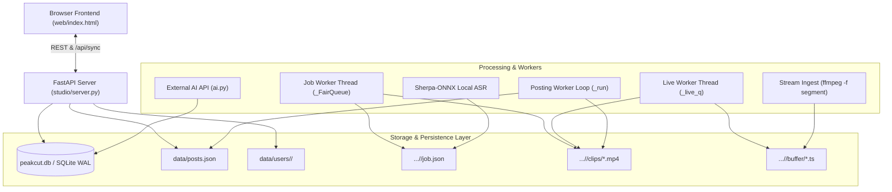
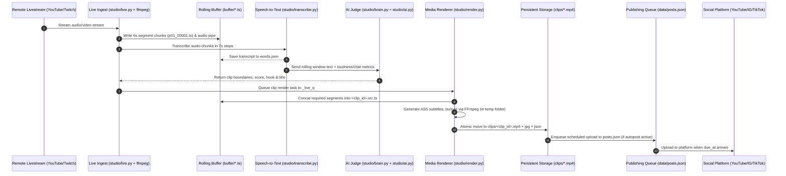

# PeakCut Persistence & Architecture Mapping

**Document:** `01_ARCHITECTURE.md`  
**Investigation Date:** 2026-11-15  
**Subject:** Read-Only Persistence Architecture & Component Lifecycle Audit  
**Target Repository:** `PeakCut` (`studio/` codebase)  

---

## 1. Executive Architecture Overview

PeakCut is an AI-assisted video clipping, processing, and multi-platform publishing platform designed for local single-user execution or multi-user server deployment.

The architecture combines:
- **FastAPI / Uvicorn** backend with asynchronous request routing and background thread workers.
- **SQLAlchemy Core** interfacing with a local SQLite database (in `WAL` journal mode) or PostgreSQL.
- **Atomic File-Backed Persistence** utilizing structured JSON files with atomic rename semantics (`.tmp` -> rename) for creator workspaces, video jobs, and publishing queues.
- **FFmpeg & yt-dlp Subprocess Pipelines** for video ingestion, rolling stream segment recording, audio extraction, loudness computation, and subtitle burn-in.
- **Sherpa-ONNX & ONNX Runtime** for local speech-to-text inference (Parakeet TDT 0.6B int8 model).
- **Stateless Vanilla Web Client** (`web/index.html`) communicating over REST endpoints and polling `/api/sync` for state invalidation.

---

## 2. Complete Lifecycle Trace

The end-to-end data processing lifecycle spans eight distinct phases:

### Lifecycle Stage Breakdown

1. **Livestream Ingestion (`studio/live.py`)**:
   - `resolve()` probes the streaming URL via `yt-dlp`.
   - `Session._ingest()` spawns `ffmpeg` writing 6-second MPEG-TS segments (`p<part>_%05d.ts`) and emitting a segment manifest (`p<part>.csv`) in the session's `buffer/` folder.
   - Raw 16kHz 16-bit mono PCM audio is simultaneously streamed over a pipe to Python for loudness calculation (`self.db`) and transcription.

2. **Rolling Buffer (`studio/live.py`)**:
   - `Session._scan_segments()` monitors `buffer/*.csv` to register newly completed `.ts` chunks.
   - Old segments exceeding `creator.buffer_min` minutes (e.g. 20 minutes) are automatically unlinked (`unlink(missing_ok=True)`).

3. **Transcription & Event Detection (`studio/transcribe.py`, `studio/live.py`)**:
   - `Session._transcribe_step()` feeds pending audio into local `sherpa-onnx` ASR.
   - Word timings are appended to `self.words` and persisted incrementally to `words.json`.
   - `_watch_spikes()` calculates loudness spikes and Twitch chat message velocity surges.
   - `_triggers()` scans for spoken trigger phrases (e.g. "clip that", "clip it").

4. **AI Clip Determination (`studio/brain.py`, `studio/ai.py`)**:
   - Dual-judge model:
     - Judge 1 inspects transcript words across the sliding window (typically 3 to 10 minutes).
     - Judge 2 checks loudness Z-scores and chat activity across the candidate interval.
   - If accepted, a clip metadata object (`clip001`, `clip002`, etc.) is added to `job["clips"]` with status `"queued"` and saved to `job.json`.

5. **Clip Slicing & Subtitle Rendering (`studio/render.py`, `studio/jobs.py`)**:
   - `Session._render()` concatenates the specific buffer chunks covering `[start - PAD, end + PAD]` into a permanent source slice: `clips/<clip_id>.src.ts`.
   - Subtitle script (`.ass`) is generated with precise word-level bouncy highlighting.
   - FFmpeg renders the vertical 9:16 clip inside a short temporary directory (`%TEMP%/pk*`) to circumvent Windows 260-character path limits.
   - Render outputs (`.mp4`, `.jpg`, `.ass`, `.json`) are moved atomically via `shutil.move()` into `clips/`.
   - Clip status transitions to `"done"` in `job.json`.

6. **Publishing Enqueue (`studio/posting.py`)**:
   - If creator has `autopost` enabled and the clip score meets `post_min_score`, `posting.enqueue()` is triggered.
   - A schedule slot is computed based on daily publication caps and inter-post intervals (`post_gap_min`).
   - The post object is appended to `data/posts.json` with status `"scheduled"` and `due_at` POSIX timestamp.
   - The post reference is mirrored into `job.json` under `clip["posts"]`.

7. **Scheduled Execution & Upload (`studio/posting.py`, `studio/accounts.py`)**:
   - `posting._run()` loops every 15 seconds.
   - When `due_at <= time.time()`, the post status transitions to `"posting"`.
   - Platform-specific uploaders execute:
     - YouTube Shorts: Resumable chunked upload via Google API v3 with automatic OAuth refresh token handling.
     - Instagram Reels: Uploads via Meta Graph API container flow.
     - TikTok: Uploads via TikTok Content Posting API.
   - On completion, `remote_id` and `url` are recorded, and status transitions to `"posted"`.

---

## 3. Detailed Component Architecture Matrix

| Component | Source File(s) | Primary Data Produced | Storage Location | Persistence Mechanism | Recovery Mechanism on Restart | Cleanup Behavior |
|---|---|---|---|---|---|---|
| **Web Server & Routing** | `studio/server.py` | HTTP responses, session cookies | Memory, `peakcut.db` | SQLite table `sessions` | Loads valid sessions from DB; `ACCOUNTS=0` bypasses auth | Stale sessions deleted after `SESSION_DAYS` |
| **System Settings** | `studio/config.py` | Environment config, directory paths | Disk (`.env`, defaults) | Plain text `.env` | Reloaded on startup via `_load_dotenv()` | Static / Never deleted |
| **User Accounts & RBAC** | `studio/db.py`, `studio/auth.py` | User rows, password hashes | `data/peakcut.db` | SQLAlchemy table `users` | Read on demand with query cache | Only deleted on explicit admin action |
| **Video Job Processing** | `studio/jobs.py` | `job.json`, audio, words | `data/users/<uid>/jobs/<jid>/` | Atomic file write (`job.json.tmp` -> replace) | `_load_file()` sets `resume=True`, `_pick_up_after_restart()` re-queues | Deleted only on user click (`jobs.delete`) |
| **In-Memory Fair Queue** | `studio/jobs.py` (`_FairQueue`) | Active queue positions | Memory only (`deque`, `dict`) | Non-persistent memory | Reconstructed on startup by scanning `job.json` files | Emptied on shutdown |
| **Livestream Recording** | `studio/live.py` | Rolling `.ts` chunks, manifests | `.../creators/<cid>/live/<jid>/buffer/` | FFmpeg file writes, `words.json` | `_load_file()` marks `was_live=True`; `live.recover()` renders pending clips; `_resume_recordings()` restarts live capture | Buffer chunks older than `buffer_min` unlinked; buffer deleted on session end |
| **Clip Rendering** | `studio/render.py` | `.mp4`, `.jpg`, `.ass` | `.../<jid>/clips/` | `shutil.move()` from temp directory | Completed clips stay on disk; interrupted renders marked `error` or re-rendered | Temp folder (`pk*`) deleted immediately in `finally` |
| **AI Decision Engine** | `studio/brain.py`, `studio/ai.py` | Token usage logs, clip boundaries | `data/peakcut.db` (`usage`), `data/ai.json` | SQLite table `usage`, JSON for API keys | DB records persist permanently; keys loaded from `ai.json` | Usage kept for cost auditing |
| **Upload Scheduler & Queue** | `studio/posting.py` | Scheduled posts list | `data/posts.json` | Atomic file write (`posts.json.tmp` -> replace) | Startup marks `"posting"` as `"failed"`; `"scheduled"` preserved and executed | Deleted only on manual cancel/job delete |
| **Social OAuth Tokens** | `studio/accounts.py` | OAuth credentials, refresh tokens | `data/users/<uid>/accounts/accounts.json` | Atomic file write (`accounts.json.tmp` -> replace) | Loaded from file; auto-refreshed via refresh token | Maintained until account disconnected |
| **Creator Workspaces** | `studio/creators.py` | Creator configs, activity log | `data/users/<uid>/creators/<cid>/creator.json`, `log.jsonl` | Atomic file write, append-only JSONL | Loaded on startup into `_mem` dictionary | Deleted only when creator is deleted |

---

## 4. Concurrency & Threading Architecture

PeakCut employs multiple long-lived daemon threads and dynamic thread pools:

1. **Job Workers (`studio/jobs.py`)**:
   - `config.JOB_WORKERS` threads executing `_worker()` for heavy video transcription and batch AI clipping.
   - Dedicated `_worker(quick_only=True)` thread prioritizing single-clip re-renders.
   - Dedicated `_live_worker()` consuming `_live_q` for live-stream clip renders and buffer cleanups.
2. **Posting Engine (`studio/posting.py`)**:
   - Background polling thread running `_run()` every 15 seconds to dispatch due uploads.
   - Background metrics thread running `_stats()` every 30 minutes to fetch remote YouTube/Instagram view counts.
   - Alert summary digest thread running `alerts.digest_loop()`.
   - Windows sleep-prevention thread running `alerts.keep_awake_loop()` (`SetThreadExecutionState`).
3. **Live Stream Workers (`studio/live.py`)**:
   - Per active stream:
     - `_ingest()` thread running FFmpeg subprocess and streaming audio pipe.
     - `_analyze()` thread running rolling speech recognition, spike checks, and AI candidate scoring.
     - Optional `_chat()` thread connected to Twitch IRC.
   - Global `watch_loop()` polling channel status every 2 minutes across configured creators.

