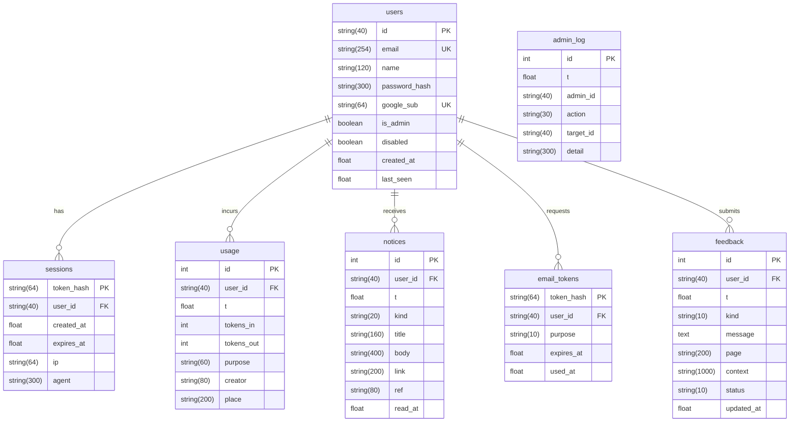

# PeakCut Storage Inventory & Data Boundaries

**Document:** `02_STORAGE_INVENTORY.md`  
**Investigation Date:** 2026-11-15  
**Subject:** Detailed File, Directory, Database Schema, and Storage Mechanism Inventory  
**Target Repository:** `PeakCut`  

---

## 1. Storage Architecture Overview

PeakCut divides its persistent state across two primary tiers:
1. **Relational Database (`peakcut.db`)**: Used strictly for user identity, authentication sessions, AI billing/token accounting, feedback, and user notification bells.
2. **Hierarchical Filesystem Storage (`data/users/` & `data/*.json`)**: Used for all heavy media, creator configurations, video job metadata, generated clips, transcripts, recording buffers, and social upload scheduling.

```
data/
├── ai.json                         # Global AI provider & model configurations (dashboard-saved)
├── apps.json                       # Server OAuth App credentials (Google, IG, TikTok)
├── peakcut.db                      # SQLite relational database (WAL mode)
├── peakcut.db-shm                  # SQLite shared-memory index
├── peakcut.db-wal                  # SQLite write-ahead log
├── posts.json                      # Master schedule & upload queue
├── fonts/                          # TrueType subtitle fonts (Anton, Archivo, Poppins)
├── models/                         # Sherpa-ONNX speech models (Parakeet TDT 0.6B int8)
├── tmp/                            # In-flight chunked web uploads (/tmp/uploads/)
└── users/
    └── <user_id>/                  # e.g., 'u_local' (default single-user owner)
        ├── accounts/
        │   ├── accounts.json       # Connected social accounts & OAuth tokens
        │   └── settings.json       # User settings (alert webhooks, posting pause)
        ├── creators/
        │   └── <creator_id>/       # e.g., 'darkviperau', 'caseoh'
        │       ├── creator.json    # Creator-specific clipping & posting rules
        │       ├── log.jsonl       # Append-only workspace activity log
        │       ├── avatar-*.img    # Cached platform profile images
        │       ├── videos/         # Manually added long videos
        │       └── live/           # Livestream recording sessions
        │           └── <job_id>/   # Format: YYYYMMDD-HHMMSS-<hex10>
        │               ├── job.json      # Job metadata, clip records, AI logs
        │               ├── words.json    # Full transcript with word-level timestamps
        │               ├── ffmpeg.log    # Ingest error/diagnostic log
        │               ├── buffer/       # Ephemeral 6s rolling stream segments (.ts, .csv)
        │               └── clips/        # Permanent rendered video clips & slices
        └── jobs/
            └── <job_id>/           # Standalone video clipping jobs (non-creator)
                ├── job.json
                ├── words.json
                ├── audio.wav (ephemeral)
                └── clips/
```

---

## 2. Database Schema (`peakcut.db`)

The database is accessed via SQLAlchemy Core in `studio/db.py`. On single-machine setups, it operates on SQLite with the following connection pragmas:
- `PRAGMA journal_mode=WAL`: Permits concurrent readers while a writer commits.
- `PRAGMA synchronous=NORMAL`: Flushes at critical WAL checkpoints; crash-safe without waiting on every write.
- `PRAGMA busy_timeout=30000`: 30-second busy lock acquisition window before failing.

### Table Schema Definitions



*Note: Jobs, clips, upload schedules, and video buffers DO NOT reside in the database.*

---

## 3. Media Storage Directories

### Permanent Media Storage
- **Location**: `data/users/<uid>/creators/<cid>/live/<jid>/clips/` or `data/users/<uid>/jobs/<jid>/clips/`
- **Files per Clip**:
  - `<clip_id>.mp4`: The final rendered vertical 9:16 clip with burned-in subtitles, hook text, and audio normalization.
  - `<clip_id>.src.ts` / `<clip_id>.src.mp4`: The trimmed original video slice (with 8s padding).
  - `<clip_id>.jpg`: Extracted high-quality video cover frame (generated at ~1.2s into clip).
  - `<clip_id>.ass`: Advanced SubStation Alpha subtitle script containing word-by-word highlight coordinates and animations.
  - `<clip_id>.json`: Standalone export metadata (title, hook, hashtags, description, score, start/end).

### Ephemeral & Temporary Media Storage
1. **Work Render Directory (`%TEMP%/pk*`)**:
   - Created in `studio/render.py` (`tempfile.mkdtemp(prefix="pk")`).
   - Purpose: Windows path length limit bypass (ffmpeg caption filter cannot handle paths > 260 characters or drive colons in filter strings).
   - Lifecycle: Created before render -> ffmpeg writes output -> files moved via `shutil.move()` to persistent `clips/` -> temporary directory purged via `shutil.rmtree()`.
2. **Livestream Rolling Buffer (`.../live/<jid>/buffer/`)**:
   - Contains: `p<part>_%05d.ts` (6-second video chunks) and `p<part>.csv` (segment start/end index).
   - Lifecycle: Rolling window determined by `creator.buffer_min` (typically 20-30 minutes). Segments older than the window are unlinked.
   - Entire buffer is unlinked when session finishes or after post-restart recovery renders pending clips.
3. **In-Flight Chunked Web Uploads (`data/tmp/uploads/`)**:
   - Contains: Partial files from `/api/upload/start` and `/api/upload/chunk`.
   - Lifecycle: Stored during client upload assembly -> unlinked on restart by `studio/server.py` (`@app.on_event("startup")`).

---

## 4. Scheduling & Queue Persistence (`data/posts.json`)

The upload queue is persisted in `data/posts.json`.

### Post Schema
```json
{
  "id": "4a40012275457b0d",
  "user": "u_local",
  "job": "20261115-101743-7483ff29c5",
  "clip": "clip003",
  "creator": "darkviperau",
  "account": "yt_UCs-iJ_Nz77AEcgDTCbJ_xFw",
  "account_name": "Fluxion",
  "platform": "youtube",
  "status": "scheduled",
  "due_at": 1794799800.0,
  "created": 1794723463.12,
  "title": "DarkViperAU Reacts to the Broken Crosshair in GTA 5",
  "score": 85,
  "tries": 0,
  "url": "",
  "remote_id": "",
  "error": null,
  "views": null
}
```

### Persistence Guarantees
- Writes are guarded by `_lock = threading.RLock()`.
- Atomic persistence pattern: writes to `posts.json.tmp`, then calls `tmp.replace(posts.json)`. On Windows/NTFS, this executes an atomic filesystem replace.
- In-memory state `_posts` is synced to disk on every state mutation (`enqueue`, `_post`, `cancel`, `retry`).

---

## 5. Configuration & OAuth Credential Storage

### Server Configuration (`.env`, `data/ai.json`, `data/apps.json`)
- `.env`: Global server environment variables (ports, host, SMTP, master paths).
- `data/ai.json`: Dashboard-configured AI provider (`gemini`, `openai`, `custom`), chosen model list, and API keys. Ignored by `.gitignore`.
- `data/apps.json`: Server-level OAuth application registrations for Google, Meta/Instagram, and TikTok. Ignored by `.gitignore`.

### User OAuth Credentials (`data/users/<uid>/accounts/accounts.json`)
- Stores connected accounts for YouTube, Instagram, and TikTok.
- Contains:
  - `access_token`: Short-lived platform API token (e.g. 1 hour).
  - `refresh_token`: Long-lived token used to obtain new access tokens.
  - `expires`: POSIX timestamp indicating access token expiration.
- File security: Written atomically with `chmod(0o600)` on POSIX systems; NTFS ACL inheritance on Windows. Never tracked by git.

