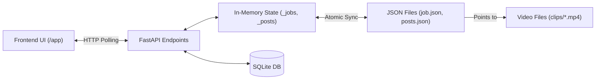

# PeakCut Live Runtime State & Evidence Audit

**Document:** `03_RUNTIME_STATE.md`  
**Investigation Date:** 2026-11-15 20:41 IST  
**Subject:** Point-in-Time System State, Active Processes, Filesystem & Database Reconciliation  
**Target Repository:** `PeakCut`  

---

## 1. Active Process Inventory

Static and live diagnostic commands confirm PeakCut is actively running with active background ingestion and rendering tasks:

| Process Name | PID | Start Time | Working Set (RAM) | Executable Path | Role in System |
|---|---|---|---|---|---|
| `python.exe` | **40976** | 2026-11-15 04:21:16 | ~766 MB | `C:\Users\Rift\AppData\Local\Programs\Python\Python314\python.exe` | Main PeakCut Server (FastAPI, background workers, ASR model) |
| `ffmpeg.exe` | **22404** | 2026-11-15 16:45:04 | ~15.4 MB | `.../ffmpeg-9.0.2-full_build/bin/ffmpeg.exe` | Active stream segmenter writing rolling `.ts` chunks to disk |
| `python.exe` | 7200 | 2026-11-15 04:21:16 | ~20 KB | `...\.venv\Scripts\python.exe` | Wrapper launcher / parent stub |

- **Listening Socket**: Port `8765` on `127.0.0.1` (TCP State: `Listen`, owning PID `40976`).
- **Active Connections**: Multiple persistent loopback connections handling UI polling.

---

## 2. In-Flight Livestream Session State

- **Creator Workspace**: `darkviperau` (`DarkViperAU`)
- **Active Job ID**: `20261115-101743-7483ff29c5`
- **Session Kind**: `live`
- **Stream Title**: `"The Last GTA 5 Speedrun - 100% | $6,767 USD !giveaway 2026-11-15 10:17"`
- **Source Channel**: `https://www.youtube.com/@DarkViperAU`
- **Ingested Stream Duration**: ~36,131 seconds (~10.03 hours continuous recording)
- **Status / Stage**: `status: "live"`, `stage: "Recording"`
- **Rolling Buffer Metrics**:
  - File count: **204 files** (3 CSV manifests: `p01.csv`, `p02.csv`, `p03.csv`, and 201 `.ts` transport stream segments)
  - Disk footprint: **557.3 MB**
  - Segment duration: **6.0 seconds per segment**
  - Total buffer window: **~1,206 seconds (~20.1 minutes)**, precisely matching `creator.buffer_min = 20`.
- **Transcript Progress**:
  - Size of `words.json`: **3.05 MB** containing word-level timestamped tokens.
- **AI Diagnostics**:
  - AI Provider: Google Gemini (`gemini-3.5-flash-lite`).
  - Total AI calls recorded in `peakcut.db` (`usage` table): **402 records**.
  - Words judge evaluations logged continuously.

---

## 3. Persistent Clips Inventory

A comprehensive recursive scan of the `data/users/` storage volume identified **28 completed vertical clips** currently preserved on persistent disk:

### A. Livestream Session Clips (`darkviperau/live/20261115-101743-7483ff29c5/clips/`)
- **Clip Count**: **22 clips** (`clip001` through `clip022`)
- **Files per Clip**: 5 files per clip (`.mp4`, `.jpg`, `.ass`, `.json`, `.src.ts`)
- **Total Files in Folder**: **110 files**
- **Clip Status in `job.json`**: All 22 clips are marked `status: "done"`.
- **Publication Breakdown**:
  - **4 Clips Published**:
    - `clip001`: `MeRi475Ib9Q` (Published 2026-11-15 11:07:43)
    - `clip002`: `fFtI3zHVzW8` (Published 2026-11-15 13:54:18)
    - `clip013`: `ri7WqUJ4_ws` (Published 2026-11-15 15:55:09)
    - `clip014`: `B_fm5SBSS_w` (Published 2026-11-15 17:33:16)
  - **10 Clips Scheduled**:
    - `clip003` through `clip012` scheduled for automated release on 2026-11-16 and 2026-11-17.
  - **8 Clips Idle / Unscheduled**:
    - `clip015` through `clip022` rendered and ready in storage awaiting manual or automated post actions.

### B. Standard Video Job Clips (`data/users/u_local/jobs/20261115-044727-b91cb3b465/clips/`)
- **Clip Count**: **6 clips** (`clip01` through `clip06`)
- **Files per Clip**: Rendered `.mp4`, source slice `.src.mp4`, cover frame `.jpg`, subtitle `.ass`, metadata `.json`
- **Total Files in Folder**: **30 files** (including 12 `.mp4` video files: 6 rendered clips + 6 trimmed source pieces)
- **Publication Breakdown**:
  - **All 6 Clips Published**:
    - `clip01`: `mli28WV2KkM` (Published 2026-11-15 06:31:43)
    - `clip02`: `jflGuBTRhv8` (Published 2026-11-15 09:32:11)
    - `clip03`: `w6swYgnWlfQ` (Published 2026-11-15 07:16:48)
    - `clip04`: `lCFzsgqOZxU` (Published 2026-11-15 10:17:09)
    - `clip05`: `INn6pMGUeIg` (Published 2026-11-15 08:47:02)
    - `clip06`: `gqukFSWnCZs` (Published 2026-11-15 08:01:56)

---

## 4. Scheduled Posts Inventory (`data/posts.json`)

Currently, `data/posts.json` tracks **20 total post records**:
- **Posted**: 10 records (all successfully uploaded to YouTube Shorts with confirmed URLs and YouTube IDs).
- **Scheduled**: 10 records (awaiting release).
- **Failed**: 0 records.
- **Cancelled**: 0 records.

### Detailed Schedule Queue

| Post ID | Target Clip | Target Channel | Scheduled Due Time (Local) | Interval | Retries |
|---|---|---|---|---|---|
| `4a40012275457b0d` | `clip003` | Fluxion (YouTube) | **2026-11-16 09:00:00** | Initial | 0 |
| `ae2d111bc7230b85` | `clip004` | Fluxion (YouTube) | **2026-11-16 09:45:00** | +45 min | 0 |
| `b665a59d23091bab` | `clip005` | Fluxion (YouTube) | **2026-11-16 10:30:00** | +45 min | 0 |
| `68e7912da9242c13` | `clip006` | Fluxion (YouTube) | **2026-11-16 11:15:00** | +45 min | 0 |
| `82aaf124461f6087` | `clip007` | Fluxion (YouTube) | **2026-11-16 12:00:00** | +45 min | 0 |
| `be48fae83952d3eb` | `clip008` | Fluxion (YouTube) | **2026-11-16 12:45:00** | +45 min | 0 |
| `7c0cb14525d50f87` | `clip009` | Fluxion (YouTube) | **2026-11-17 09:00:00** | Next day 9am | 0 |
| `efa4d33dcce8e675` | `clip010` | Fluxion (YouTube) | **2026-11-17 09:45:00** | +45 min | 0 |
| `0aa921f4be32d256` | `clip011` | Fluxion (YouTube) | **2026-11-17 10:30:00** | +45 min | 0 |
| `eeaba79ffe485613` | `clip012` | Fluxion (YouTube) | **2026-11-17 11:15:00** | +45 min | 0 |

---

## 5. Reconciliation Across System Layers

| Entity | UI Count | In-Memory Object Count | Disk File Count | Database Count | Consistency Status |
|---|---|---|---|---|---|
| **Creators** | 8 | 8 in `_mem['u_local']` | 8 folders in `creators/` | N/A (not in DB) | **100% Consistent** |
| **Active Live Recordings** | 1 | 1 in `SESSIONS` | 1 active folder with lock | N/A (not in DB) | **100% Consistent** |
| **Completed Video Jobs** | 1 | 1 in `_by_user['u_local']` | 1 in `users/u_local/jobs/` | N/A (not in DB) | **100% Consistent** |
| **Completed Clips (DarkViperAU)** | 22 | 22 in `job["clips"]` | 22 `.mp4` files in `clips/` | N/A (not in DB) | **100% Consistent** |
| **Completed Clips (Job 1)** | 6 | 6 in `job["clips"]` | 6 `.mp4` files in `clips/` | N/A (not in DB) | **100% Consistent** |
| **Scheduled Posts** | 10 | 10 in `_posts` | 10 in `posts.json` | N/A (not in DB) | **100% Consistent** |
| **Published Posts** | 10 | 10 in `_posts` | 10 in `posts.json` | N/A (not in DB) | **100% Consistent** |
| **AI Usage Records** | Brief token count | In-memory cache | N/A (stored in DB) | 402 rows in `usage` | **100% Consistent** |
| **Registered Users** | 1 | 1 cached `auth._local` | N/A | 1 row in `users` (`u_local`) | **100% Consistent** |

**Conclusion of Reconciliation**:  
There is zero drift between the in-memory state, the filesystem JSON records, the rendered video artifacts, and the database. All completed media files referenced in metadata exist and are intact.

